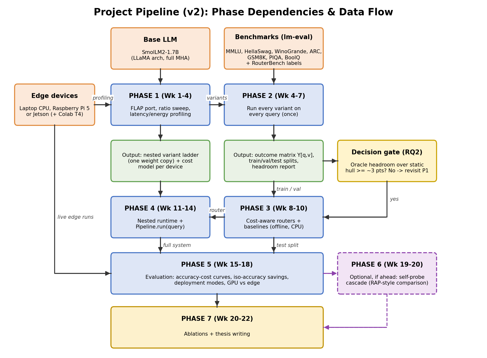
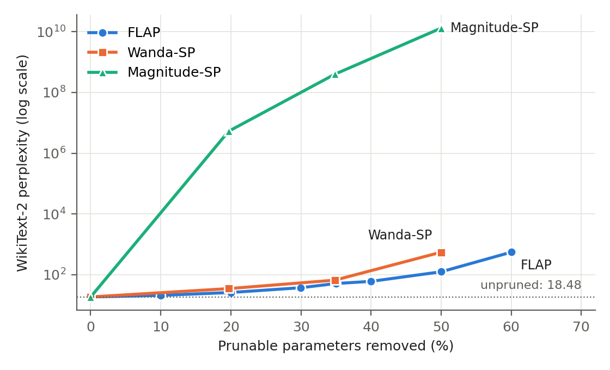
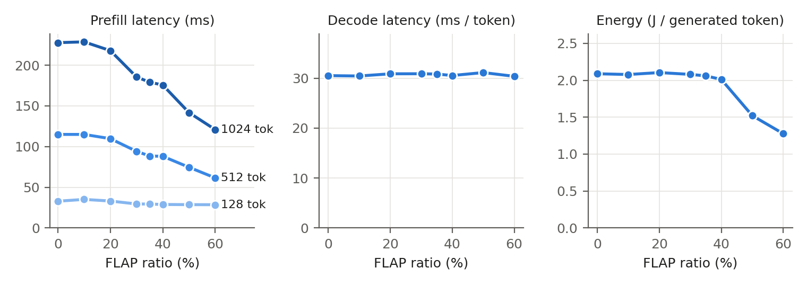

# Query-Adaptive Compression-Level Routing for Edge LLM Inference

**B.Tech Thesis — Mid-Semester Report**

**Saksham Bansal** (f20220524@pilani.bits-pilani.ac.in)
Supervisor: **Prof. Hari Babu**, BITS Pilani

> Every number in this report is taken from a result file in the project repository (`flap-routing/`). Items that are still being measured are marked **[pending]**; nothing is estimated.

---

## Abstract

We study whether choosing an LLM's compression level per query pays off on edge hardware. We port FLAP, a retraining-free structured pruning method, to SmolLM2-1.7B. This gives a ladder of nested pruned variants of one model, stored as small pruning plans over a single copy of the weights. We build a 19,242-question pool from eight benchmarks, with reproducible splits and a scoring pipeline that checks every result against the evaluation harness.

On a Tesla T4, FLAP raises WikiText-2 perplexity from 18.48 to 25.94 at 20% and to 124.62 at 50% of prunable parameters removed. Wanda-SP reaches 549.25 at 50%, and Magnitude-SP fails at every ratio, which reproduces the FLAP paper's method ranking at this scale. Pruning 50% cuts 1024-token prefill latency by 38% and energy per generated token by 27%. However, batch-1 decode latency stays at 30.4–31.1 ms per token for every ratio.

On 3,849 test questions, macro accuracy falls from 62.5% (unpruned) to 47.3% (FLAP 20%), 40.0% (FLAP 35%) and 32.6% (FLAP 50%). Several pruned variants collapse to a constant answer on MMLU and BoolQ, and fail to finish GSM8K answers.

A per-query oracle over the variants reaches 75.8%, against 64.1% for the best fixed variant. But once variants that do not beat a constant answer are excluded, the gain shrinks to 1.9 points (66.1%). So on this GPU the headroom for per-query compression routing is small. Laptop-CPU latencies are pending.

---

## 1. Introduction

Small open language models (1–3 B parameters) can now run on edge-class hardware, but every query is still answered with the same fixed amount of computation. Structured pruning methods such as FLAP [3] and SliceGPT [4] reduce that computation without retraining, but they fix one compression ratio at deployment time. Queries, however, differ in difficulty: a heavily pruned model may answer an easy question correctly and fail a hard one.

This thesis studies whether choosing the compression level *per query* pays off on edge hardware. We build a ladder of FLAP-pruned variants of one model (SmolLM2-1.7B [17]). We measure every variant on every query of a 19,242-question pool drawn from eight standard benchmarks, and ask how much accuracy-per-cost a router could gain over running one fixed variant.

In the resource-management taxonomy of Walia et al. [1], the compression level is the resource being allocated, and the router makes a per-request scheduling/provisioning decision. Neither that survey nor the MCDS scheduler [2] treats LLM-inference workloads.

**Status at mid-semester.**
- **Complete and verified:** Phase 0 (infrastructure).
- **Implemented, tested and run on a Colab T4:**
  - Phase 1: the FLAP port, the ratio sweep and the baselines.
  - Phase 2 on the test split: the query pool, scoring pipeline and external labels, plus the outcome runs of four variants and the headroom analysis.
- **Deferred:** laptop-CPU latency measurements (Section 9.2) and the Phase 2 outcome runs on the train/validation splits.

**Research questions**
- **RQ1:** Does FLAP give a useful accuracy–cost ladder on a ~1.7 B edge model, and does the paper's ranking (FLAP > Wanda-SP > Magnitude-SP) hold at this scale?
- **RQ2:** How much can a per-query choice of compression level gain over the best fixed level (oracle headroom)?
- **RQ3:** How much of that headroom does a cheap router recover, and does it beat routing by task type alone?
- **RQ4:** What are the end-to-end latency, energy and memory savings on a GPU and on a laptop CPU?

This report answers RQ1 and gives a first answer to RQ2 on the GPU. RQ3 and RQ4 are planned (Section 11).

---

## 2. Related Work

**Resource management at the edge.**
- Walia et al. [1] survey AI-based resource management (provisioning, offloading, scheduling, placement, load balancing) in fog/edge systems.
- Tuli et al. [2] schedule workflow DAGs with Monte-Carlo tree search and a learned surrogate.
- Neither addresses LLM inference.

**Retraining-free structured pruning.**
- FLAP [3] scores channels by the fluctuation of their inputs. It chooses per-layer ratios through a global standardised threshold and adds a bias that compensates for the removed channels.
- SliceGPT [4] rotates the weights and deletes rows and columns.
- Wanda [5] uses weight × activation importance. Its structured variant Wanda-SP is evaluated in FLAP.
- LLM-Pruner [6] needs LoRA fine-tuning to recover accuracy.

**Input-adaptive and elastic compression.**
- PuDDing [7] trains a router that selects one of several *depth*-pruned variants per prompt at a fixed sparsity.
- Instruction-Following Pruning [8] predicts per-prompt structured masks with a trained predictor.
- Flextron [9] and MatFormer [10] train nested elastic models.
- RAP [11] uses reinforcement learning to choose a pruning policy from sequence length, batch size and the available memory budget.

**Query routing.**
- RouterBench [12] benchmarks routing across 11 LLMs and evaluates routers against the convex hull of the fixed models.
- RouteLLM [13] and Hybrid LLM [14] route between a strong and a weak model.
- ConsRoute [15] and HybridFlow [16] route across device, edge and cloud model tiers.

---

## 3. Novelty and Positioning

Per-prompt selection among pruned variants is **not** new: PuDDing [7] does it for depth pruning. The contribution claimed here is narrower:

1. **A training-free ladder of nested width-pruned (FLAP) variants of one model.** Nesting follows from FLAP's global threshold (Proposition 1, Section 6). It lets one copy of the weights serve every variant.
2. **Choosing *how much* to compress per query** (variable budget, cost-aware). This differs from choosing *which* structure to keep at a fixed budget (PuDDing, IFPruning) and from reacting to memory pressure (RAP).
3. **An edge-hardware measurement of when per-query compression routing pays off:** oracle headroom, how much of it a router recovers, and end-to-end latency/energy on a Colab T4 and on a laptop CPU.

Prior routing work routes between *separate* models. Pruned variants of one model are expected to fail on largely the same queries. So the headroom available to a router is an open empirical question (RQ2), not an assumption.

---

## 4. Problem Formulation

Let **V** = {v₀, …, v_K} be pruned variants of one model, with v₀ unpruned, ordered by cost. For a query set Q:

- **Y[q, v] ∈ {0, 1}**: whether v answers q correctly (the primary metric of q's task, Section 8).
- **c(q, v)**: the cost (latency in ms, or energy in J) of answering q with v on a given device.

A router is a map π: Q → V. Its accuracy and cost are

    A(π) = (1/|Q|) Σ_q Y[q, π(q)]
    C(π) = (1/|Q|) Σ_q c(q, π(q)) + c_router

The goal is the accuracy–cost frontier: for a cost budget B, maximise A(π) subject to C(π) ≤ B. Its Lagrangian relaxation gives the decision rule for the learned router (Phase 3):

    π_λ(q) = argmax_v  p̂_v(q) − λ · c̃(q, v)

Here p̂_v(q) estimates Pr[Y[q, v] = 1 | q] from features of the query text only. Sweeping λ ≥ 0 traces a curve rather than a single operating point.

**Reference points.**
- **Fixed variant:** a fixed variant v gives the point (C_v, A_v).
- **Random mixing:** mixing two fixed variants with probability α gives (αC_v + (1−α)C_v′, αA_v + (1−α)A_v′). So the upper concave envelope H(·) of the fixed points is achievable without looking at the query. This is RouterBench's baseline.
- **Per-query oracle:** picks the cheapest correct variant, or the cheapest variant if none is correct:

      A_oracle = (1/|Q|) Σ_q max_v Y[q, v]
      headroom = A_oracle − H(C_oracle)

A router is useful only if its curve lies above H. The headroom bounds how far above it can be.

---

## 5. Solution Design

*Figure 1. Pipeline and phase dependencies. P0–P2 are covered in this report.*

1. **Variant ladder (P1).**
   - FLAP is computed once on the unpruned model; a pruning ratio r then only selects a threshold.
   - Each variant is stored as a *plan*: per-layer head and channel keep-masks plus compensation biases. A plan is about 0.6 MB (safetensors) and is applied to the base weights at load time.
2. **Outcome matrix (P2).**
   - Every variant is evaluated once on every query with lm-evaluation-harness [18].
   - Each run records correctness, the log-likelihood of every answer option, prompt length and generated length.
   - Routers are then evaluated offline by replaying this matrix, so no GPU time is spent per router or per λ. Live runs on a subset will confirm the replay.
3. **Routers (P3).**
   - Estimators of p̂_v(q): rule-based, kNN, logistic regression and MLP, on MiniLM sentence embeddings plus length and math features, combined with the decision rule above.
   - Compared against: fixed variants, the random-mixture hull, a task-type router, a router trained on RouterBench's 11-LLM correctness, and the oracle.
4. **Runtime (P4) and evaluation (P5).**
   - A shared-weight runtime serves all variants from one weight copy.
   - Three deployment modes are compared under a memory budget: shared weights, all variants resident, and swap on demand.

**Engineering for correctness.**
- Every script is seeded and config-driven.
- Each writes its configuration, git commit (with a dirty flag), library versions and logs next to its results.
- The code base has **55 automated tests**.
- Problems found and fixed during the work, each now covered by a test, are listed in Appendix A.

---

## 6. Mathematical Basis

### 6.1 FLAP importance, structure and compensation

Take an output projection W ∈ ℝ^{d×m} (the attention o-projection or the MLP down-projection) with input channels j = 1..m. FLAP accumulates, over calibration samples t = 0..N−1 (each a window of T tokens), a running mean x̄_j and a fluctuation F_j:

    x̄_j(t) = t/(t+1) · x̄_j(t−1) + 1/(t+1) · (1/T) Σ_τ x[t, τ, j]
    F_j(t) = (t−1)/t · F_j(t−1) + 1/(t+1) · Σ_τ (x[t, τ, j] − x̄_j(t))²,   F_j(0) = 0

The second line is what the official implementation actually computes. Its "previous mean" is an alias of the updated mean, so both factors use x̄(t). Our port reproduces this, and a unit test pins it.

**Score, structure and threshold:**
1. The WIFV score is S_j = F_j · ‖W_{:,j}‖², and attention scores are squared.
2. Scores are standardised within each layer, Ŝ_j = (S_j − μ_ℓ)/σ_ℓ. A head's score is the mean of Ŝ over its d_h channels.
3. All heads and MLP channels of all layers are ranked together, and the kept set is {u : Ŝ_u > τ(r)}.
4. τ(r) is chosen so the kept parameter weight is closest to (1 − r) of the total. A head has weight ⌊4·d_h/3⌋ and an MLP channel has weight 1, because a head owns 4·d·d_h parameters and a channel owns 3·d.

**Bias compensation.** Removing input channels P of a linear layer changes its output y = W_K x_K + W_P x_P. FLAP replaces the removed term by its calibration expectation, i.e. it adds the bias

    b = W_{:,P} · x̄_P

**Proposition 1 (Nested variants).** With scores computed once on the unpruned model, K(r₂) ⊆ K(r₁) for r₂ ≥ r₁.

*Proof.*
- The ranking does not depend on r.
- The cumulative kept weight increases along the ranking, while the target (1 − r)·Σw decreases in r. So the selected rank index is non-increasing in r.
- Hence the threshold τ(r) is non-decreasing, and any unit with Ŝ_u > τ(r₂) also has Ŝ_u > τ(r₁). ∎

So a variant v_r is a sub-network of every less-pruned variant, and all variants can be served from one weight copy plus small per-variant bias vectors. The test suite checks nesting numerically.

**Parameter count.** With h_ℓ kept heads and m_ℓ kept MLP channels in layer ℓ, the prunable parameters are Σ_ℓ (4·d·d_h·h_ℓ + 3·d·m_ℓ). Embeddings are not pruned.

### 6.2 Cost and energy

The batch-1 latency of a query with n prompt tokens and g generated tokens on variant v is modelled as

    c(q, v) = prefill_v(n) + g · decode_v

- prefill_v is interpolated linearly between the measured prompt lengths.
- Multiple-choice tasks are scored by log-likelihood, so g = 0 for them.
- Energy is E = ∫P dt, read as the difference of the NVML cumulative energy counter. A 20 ms power sampler integrated by the trapezoid rule serves as a cross-check.

### 6.3 Metrics

- **Multiple choice.** For option log-likelihoods ℓ_i, option character lengths |o_i| and gold option g:
  - acc = [argmax_i ℓ_i = g]
  - acc_norm = [argmax_i ℓ_i/|o_i| = g]
- **Perplexity on WikiText-2** follows FLAP: non-overlapping 128-token windows, PPL = exp(mean token negative log-likelihood).

---

## 7. Experimental Setup

| Item | Setting |
|---|---|
| Base model | SmolLM2-1.7B (`HuggingFaceTB/SmolLM2-1.7B`, revision `effd688a`). Llama architecture, 24 layers, hidden 2048, 32 attention heads with 32 key/value heads (full multi-head attention), head dim 64, MLP 8192, no biases, tied embeddings, vocabulary 49,152. 1,711,376,384 parameters. |
| GPU | Google Colab, NVIDIA Tesla T4 (16 GB), fp16, Python 3.13 |
| Edge device | Laptop CPU: Intel Core i5-12500H, 15.6 GB RAM, Windows 11, PyTorch 2.7.0 (CPU), 12 threads, fp32 |
| Software | transformers 5.17.0, lm-eval 0.4.13, datasets 5.0.1, accelerate 1.15.0, huggingface-hub 1.33.0 (pinned). PyTorch is Colab's build, recorded per run. |
| FLAP settings | As in the official code: WIFV metric, AL-AM structure, WikiText-2 [26] train calibration, 1024 windows of 128 tokens, seed 0. PPL with 128-token windows. Ratios 0.1–0.6. |
| Baselines | Wanda-SP and Magnitude-SP at ratios 0.2 / 0.35 / 0.5, uniform per layer. Wanda-SP is calibrated on 128 WikiText-2 windows instead of C4, so all methods see the same text. |
| Latency protocol | Batch 1. Random-token prompts of 128/512/1024 tokens (GPU) or 128/512 (CPU). 64 (GPU) or 32 (CPU) generated tokens with EOS suppressed. Median over 10 (GPU) or 5 (CPU) repetitions after warm-up. CUDA-synchronised. CPU runs require mains power. |
| Seeds | Pool and splits: 2026. FLAP calibration: 0. lm-eval few-shot seed: 2026 for every variant. |

---

## 8. Datasets

| Task | Eval docs | Dupes | Kept | Train / Val / Test | Metric | Shots | HF dataset |
|---|---:|---:|---:|---|---|---:|---|
| ARC-Easy | 2,376 | 0 | 2,376 | 1,426 / 475 / 475 | acc | 0 | `allenai/ai2_arc` |
| ARC-Challenge | 1,172 | 0 | 1,172 | 703 / 234 / 235 | acc_norm | 0 | `allenai/ai2_arc` |
| HellaSwag | 10,042 | 0 | 4,000 (cap) | 2,400 / 800 / 800 | acc_norm | 0 | `Rowan/hellaswag` |
| WinoGrande | 1,267 | 0 | 1,267 | 760 / 253 / 254 | acc | 0 | `allenai/winogrande` |
| PIQA | 1,838 | 0 | 1,838 | 1,103 / 368 / 367 | acc | 0 | `baber/piqa` |
| BoolQ | 3,270 | 0 | 3,270 | 1,962 / 654 / 654 | acc | 0 | `aps/super_glue` |
| MMLU | 14,042 | 105 | 4,000 (cap) | 2,397 / 803 / 800 | acc | 0 | `cais/mmlu` |
| GSM8K | 1,319 | 0 | 1,319 | 791 / 264 / 264 | exact match | 5 | `openai/gsm8k` |
| **Total** | | | **19,242** | **11,542 / 3,851 / 3,849** | | | |

*Table 1. Query pool (lm-eval 0.4.13, seed 2026). Dataset revisions (Hub commit hashes) are recorded in `data/p2/manifest.json`.*

**How the pool is built.**
- It is built from lm-eval's own task definitions, so document order, gold labels and prompts are exactly those lm-eval evaluates.
- Each row stores lm-eval's document hash, and the outcome parser rejects any logged sample whose hash differs.
- Exact duplicates (same question and options) are dropped: 105 in MMLU.
- MMLU [19] is capped at 4,000 questions, allocated to subjects in proportion to their size. HellaSwag [20] is capped at 4,000, sampled uniformly.
- The other tasks are used in full: ARC-Easy/Challenge [22], WinoGrande [21], PIQA [23], BoolQ [24], GSM8K [25].
- Each task (and each MMLU subject) is split 60/20/20 into train/validation/test with seed 2026. Rebuilding the pool reproduces it exactly.

**Scoring.**
- **Multiple-choice tasks:** zero-shot, scored by option log-likelihood. The primary metric is acc_norm for HellaSwag and ARC-Challenge and acc elsewhere (the LLM-Pruner/FLAP reporting convention); both are stored.
- **GSM8K:** 5-shot, greedy generation capped at 256 tokens. An answer is correct if the extracted number matches (lm-eval's *flexible-extract* filter); strict match is stored too.

**External difficulty labels (RouterBench).**
- **What they are.** RouterBench [12] (0-shot file, revision `78402148`, SHA-256 `ba4f77f19517…`) records whether each of 11 LLMs answered a prompt correctly. We attach the mean correctness over these models to our queries as an *external* difficulty label, used only in a later ablation.
- **Safe loading.** The file is a Python pickle, so it is loaded with a restricted unpickler that permits only 11 pandas/numpy reconstruction functions.
- **Matching.** Questions are matched by content with answer options sorted, because RouterBench shuffles option order. Queries whose key occurs in RouterBench with different scores are left unlabelled.
- **Result.** 10,420 of our queries are labelled:

| Task | Pool | RouterBench rows | Matched | Ambiguous | Note |
|---|---:|---:|---:|---:|---|
| HellaSwag | 4,000 | 10,042 | 4,000 | 0 | |
| WinoGrande | 1,267 | 1,267 | 1,267 | 0 | |
| ARC-Challenge | 1,172 | 1,470 | 1,172 | 0 | |
| MMLU | 4,000 | 14,042 | 3,981 | 19 | |
| GSM8K | 1,319 | 7,450 | 0 | 0 | RouterBench uses the GSM8K train split |
| ARC-Easy / PIQA / BoolQ | 2,376 / 1,838 / 3,270 | 0 | 0 | – | not in RouterBench |

*Table 2. Matching our pool to RouterBench.*

---

## 9. Results and Analysis

### 9.1 Measurement infrastructure (P0)

On the Colab Tesla T4, all environment checks passed:
- **Seeding** reproduced identical tensors.
- **Pruned-model shapes.** A model whose layers have different numbers of heads and MLP channels plus compensation biases (the shape FLAP produces) gave the same logits whether pruned physically or by masking. This held in fp32 and fp16 and with eager and SDPA attention; the maximum fp16 logit difference was 0.0.
- **Energy counter.** The NVML energy counter is supported on the T4 and agrees with the independent 20 ms power sampler:

| Condition | Counter | Sampler | Gap | Duration | Mean power |
|---|---:|---:|---:|---:|---:|
| Idle | 30.2 J | 30.7 J | 1.7% | 3.0 s | 10.2 W |
| fp16 matrix-multiply load (23.6 TFLOPS) | 692.4 J | 700.0 J | 1.1% | 10.0 s | 69.7 W |

Energy figures in this work therefore use the counter.

### 9.2 Pruned-variant ladder (P1)

| Variant | Achieved (%) | Params (B) | WikiText-2 PPL | Prefill 512 (ms) | Decode (ms/tok) | J/token |
|---|---:|---:|---:|---:|---:|---:|
| unpruned | 0.0 | 1.711 | 18.48 | 114.9 | 30.5 | 2.088 |
| FLAP 10% | 10.0 | 1.551 | 20.82 | 114.9 | 30.4 | 2.078 |
| FLAP 20% | 20.0 | 1.389 | 25.94 | 109.8 | 30.9 | 2.104 |
| FLAP 30% | 30.0 | 1.228 | 37.22 | 94.2 | 30.9 | 2.079 |
| FLAP 35% | 35.0 | 1.148 | 51.12 | 88.4 | 30.8 | 2.059 |
| FLAP 40% | 40.0 | 1.067 | 60.30 | 88.1 | 30.5 | 2.011 |
| FLAP 50% | 50.0 | 0.906 | 124.62 | 74.6 | 31.1 | 1.521 |
| FLAP 60% | 60.0 | 0.745 | 550.44 | 61.5 | 30.4 | 1.276 |
| Wanda-SP 20% | 19.7 | 1.394 | 34.77 | 107.0 | 30.2 | 2.076 |
| Wanda-SP 35% | 34.8 | 1.150 | 65.99 | 113.8 | 29.3 | 1.989 |
| Wanda-SP 50% | 50.0 | 0.906 | 549.25 | 60.7 | 29.4 | 1.500 |
| Mag-SP 20% | 19.7 | 1.394 | 5.3×10⁶ | 108.0 | 29.2 | 2.003 |
| Mag-SP 35% | 34.8 | 1.150 | 4.0×10⁸ | 113.4 | 29.6 | 2.012 |
| Mag-SP 50% | 50.0 | 0.906 | 1.3×10¹⁰ | 59.1 | 29.6 | 1.469 |

*Table 3. FLAP sweep and baselines on SmolLM2-1.7B (Colab T4, fp16, batch 1).*
- "Achieved" is the fraction of prunable (attention and MLP) parameters removed; embeddings are not pruned.
- Decode is per generated token after a 128-token prompt.
- J/token is GPU energy (NVML counter) per generated token.

*Figure 2. WikiText-2 perplexity (log scale) against the fraction of prunable parameters removed.*

*Figure 3. FLAP variants on the T4 (batch 1, fp16): prefill latency for three prompt lengths, decode latency per token, and GPU energy per generated token.*

**Analysis: quality.**
- At every ratio tested (20%, 35%, 50%), the perplexity ranking FLAP < Wanda-SP < Magnitude-SP holds, as the FLAP paper reports for LLaMA.
- FLAP's perplexity rises from 18.48 (unpruned) to:
  - 25.94 at 20% (×1.40);
  - 51.12 at 35% (×2.77);
  - 124.62 at 50% (×6.74).
- Wanda-SP reaches 549.25 at 50%. Magnitude-SP is unusable at every ratio (5.3×10⁶ already at 20%).
- FLAP's adaptive structure is visible in the plans: at 50%, one layer keeps only 4 of its 32 heads, while the uniform baselines keep 16 in every layer.

**Analysis: latency and energy on the T4.**
- **Decode latency does not change with the pruning ratio:** 30.4–31.1 ms per token from 0% to 60%. All individual 64-token generations took 1.89–2.19 s.
  - So width pruning does not shorten generation here.
  - This is consistent with batch-1 decoding of a 1.7 B model on this GPU being dominated by fixed per-step overheads rather than by the size of the weight matrices. The cause was not measured directly.
- **Prefill gets faster, more so for longer prompts.** At 50% pruning:

| Prompt length | Unpruned | FLAP 50% | Change |
|---|---:|---:|---:|
| 1024 tokens | 227.7 ms | 141.7 ms | −38% |
| 512 tokens | 114.9 ms | 74.6 ms | −35% |
| 128 tokens | 32.9 ms | 28.7 ms | barely changes |

- **Energy per generated token** falls from 2.09 J to 1.52 J (−27%) at 50%. The mean GPU power during generation drops from 67.9 W to 48.9 W over the same duration.
- **Peak GPU memory** falls from 6.48 GB to 5.00 GB.

So on this GPU, the latency benefit of width pruning is limited to prefill, while the energy and memory benefits are measurable.

**Laptop CPU (edge device): [pending].** Two attempts did not give trustworthy timings, so no CPU numbers are reported.

1. **First attempt (discarded).** The laptop was on battery with the CPU throttled (about 55% performance, about 1.97 GHz). Repetition spreads reached 2×, and the variants were non-monotonic in size.
2. **Second attempt (on mains power, "Best performance" mode).** Processor performance still varied between 31% and 61%.
   - The unpruned model measured 443 ms/token at the start of the session and 510 ms/token in a repeat at the end (+15%).
   - FLAP-20% measured slower than the unpruned model.

Both sets of runs are kept in the repository and marked `INVALID` or `PRELIMINARY`. CPU timing is deferred to a dedicated measurement step (Section 11).

### 9.3 Accuracy and oracle headroom (P2)

The unpruned model and FLAP-20/35/50% were each evaluated on the 3,849 test-split questions on the T4. All four runs were made from the same clean commit.

**Reproducibility.** Runs repeated in separate Colab sessions on different days gave identical results, question by question:
- unpruned: 3 runs; FLAP-50%: 2 runs; FLAP-20%: 2 runs;
- correctness, predictions and prompts all 100% identical.

**Fairness and integrity checks.**
- All four variants received byte-identical prompts, including GSM8K's 5-shot examples.
- No GSM8K prompt was at risk of truncation (the longest was 1,471 tokens).
- Every logged answer passed the integrity checks against lm-eval.

| Task | Unpruned | FLAP 20% | FLAP 35% | FLAP 50% |
|---|---:|---:|---:|---:|
| ARC-Challenge | 51.1 | 33.6 | 31.9 | 28.5 |
| ARC-Easy | 78.1 | 65.1 | 53.7 | 32.4 |
| BoolQ | 73.2 | 63.3 | 52.1 | 37.0 |
| GSM8K | 31.8 | 3.0 | 2.3 | 1.1 |
| HellaSwag | 72.2 | 56.5 | 39.6 | 26.1 |
| MMLU | 46.4 | 24.8 | 24.1 | 24.1 |
| PIQA | 81.2 | 74.4 | 65.9 | 60.8 |
| WinoGrande | 66.1 | 57.5 | 50.4 | 50.8 |
| **Macro average** | **62.5** | **47.3** | **40.0** | **32.6** |

*Table 4. Accuracy (%) on the test split, primary metric per task.*

**Cost per question.** Mean modelled T4 latency per test question:

| Variant | Cost (ms) |
|---|---:|
| Unpruned | 291.6 |
| FLAP 20% | 506.9 |
| FLAP 35% | 573.2 |
| FLAP 50% | 577.0 |

The cost is the measured prefill latency at the question's prompt length, plus measured decode latency × generated tokens for GSM8K. The pruned variants are *more* expensive because of GSM8K (Table 6): they generate up to the 256-token limit. On the multiple-choice tasks, all four variants cost about the same on the T4 (21.3–22.5 ms per question).

**Collapse of the pruned variants.** Accuracy alone hides how the pruned variants fail. Table 5 gives, for each multiple-choice task, the share of questions on which a variant gives its single most frequent answer. 100% means it answers every question identically. "Constant" is the accuracy of always giving the most common correct answer.

| Task | Constant | Unpruned | FLAP 20% | FLAP 35% | FLAP 50% |
|---|---:|---:|---:|---:|---:|
| ARC-Easy | 29.3 | 29 | 31 | 34 | 33 |
| ARC-Challenge | 28.9 | 27 | 27 | 29 | 32 |
| HellaSwag | 28.0 | 27 | 26 | 27 | 28 |
| WinoGrande | 51.2 | 52 | 52 | 53 | 56 |
| PIQA | 50.1 | 51 | 55 | 55 | 52 |
| BoolQ | 63.0 | 71 | **99** | 55 | **100** |
| MMLU | 26.6 | 32 | **87** | **100** | **100** |

*Table 5. Share (%) of test questions receiving each variant's most frequent answer.*

- **MMLU:** FLAP-35% and FLAP-50% answer "A" to every question, so their 24.1% accuracy is simply the share of questions whose answer is A.
- **BoolQ:** FLAP-20% answers "yes" to 99% of questions and FLAP-50% answers "no" to all of them.

| Variant | GSM8K accuracy (%) | Mean tokens | Median tokens | At 256-token limit (%) |
|---|---:|---:|---:|---:|
| Unpruned | 31.8 | 122 | 109 | 6.4 |
| FLAP 20% | 3.0 | 222 | 256 | 80.3 |
| FLAP 35% | 2.3 | 256 | 256 | 100.0 |
| FLAP 50% | 1.1 | 256 | 256 | 100.0 |

*Table 6. GSM8K generation on the test split: the pruned variants mostly never finish an answer.*

**Oracle headroom.** The plain oracle (Section 4) counts a question as solved if *any* variant answers it correctly. When some variants answer every question identically, combining them "solves" questions that no router could identify: an always-"yes" and an always-"no" variant together cover all of BoolQ.

We therefore also report an **informative oracle**: on each task, a variant may be chosen only if its accuracy beats the best constant answer (one-sided binomial test, p < 0.01). For GSM8K, which has no constant answer, any correct answer counts.

| Cost model | Best fixed | Oracle | Informative oracle | Independent errors |
|---|---|---|---|---|
| T4 GPU | unpruned: 64.1 @ 291.6 ms | 75.8 @ 290.1 ms | **66.1 @ 291.4 ms** | 92.5 |

*Table 7. Accuracy (%) @ mean cost per question.*
- Accuracy here is pooled over all 3,849 questions; Table 4's macro average weights the eight tasks equally. That is why the unpruned model shows 64.1 here and 62.5 there.
- "Independent errors" is the oracle accuracy expected if the variants' mistakes were unrelated, 1 − Π_v(1 − A_v).

| Task | n | Constant | Best fixed | Oracle | Informative oracle | Variants above the constant answer |
|---|---:|---:|---:|---:|---:|---|
| ARC-Easy | 475 | 29.3 | 78.1 | 84.0 | 82.7 | unpruned, FLAP 20%, FLAP 35% |
| ARC-Challenge | 235 | 28.9 | 51.1 | 61.7 | 51.1 | unpruned |
| HellaSwag | 800 | 28.0 | 72.2 | 77.0 | 75.0 | unpruned, FLAP 20%, FLAP 35% |
| WinoGrande | 254 | 51.2 | 66.1 | 87.4 | 66.1 | unpruned |
| PIQA | 367 | 50.1 | 81.2 | 86.4 | 86.4 | all four |
| BoolQ | 654 | 63.0 | 73.2 | 100.0 | 73.2 | unpruned |
| MMLU | 800 | 26.6 | 46.4 | 58.8 | 46.4 | unpruned |
| GSM8K | 264 | – | 31.8 | 36.0 | 36.0 | all four |

*Table 8. Per-task accuracy (%) on the test split.*

| Variant | Both right | Only pruned right | Only unpruned right | Both wrong |
|---|---:|---:|---:|---:|
| FLAP 20% | 43.2 | 5.6 | 20.9 | 30.3 |
| FLAP 35% | 33.3 | 7.1 | 30.8 | 28.7 |
| FLAP 50% | 23.4 | 8.3 | 40.7 | 27.6 |

*Table 9. Outcome overlap with the unpruned model (% of test questions).*

**Analysis.**
- **The plain oracle overstates the gain.** It reaches 75.8% against 64.1% for the best fixed variant (+11.7 points). Most of that comes from tasks where the pruned variants are no better than a constant answer: BoolQ 73.2 → 100.0, WinoGrande 66.1 → 87.4, MMLU 46.4 → 58.8, ARC-Challenge 51.1 → 61.7.
- **The honest gain is small.** With only informative variants allowed, the oracle reaches 66.1% (+1.9 points), at essentially the same T4 cost, and it still picks the unpruned model for 95.7% of questions.
- **Where the real gain comes from.** It comes only from ARC-Easy (+4.6), HellaSwag (+2.8), PIQA (+5.2) and GSM8K (+4.2), the tasks where the pruned variants still carry real information.
- **The variants fail on the same questions.** The observed oracle (75.8%) is far below the independent-errors reference (92.5%).
- **24.2%** of test questions are answered correctly by no variant.
- **Answer to RQ2 (on the T4):** with FLAP at 20–50% on this 1.7 B model, per-query compression routing has little to gain. The pruned variants either collapse on a task or cost about the same per multiple-choice question, and they cost more on generation. Whether this changes under an edge-CPU cost model, and at milder ratios (10–20%), is the next question (Section 11).

---

## 10. Conclusion

**Infrastructure.** The infrastructure for the study is in place and verified:
- a seeded, config-driven pipeline with recorded provenance;
- a faithful and tested port of FLAP and two baselines;
- a reproducible 19,242-question pool;
- a scoring pipeline whose every result is cross-checked against lm-eval.

**First measurements.**
- **RQ1:** FLAP produces a steep accuracy–cost ladder on a 1.7 B model (perplexity ×1.40 at 20%, ×6.74 at 50%) and keeps its advantage over Wanda-SP and Magnitude-SP.
- **T4 behaviour:** at batch size 1, width pruning reduces prefill latency, energy and memory, but not decode latency. So the cost model used for routing must be measured per device rather than assumed proportional to parameter count.

**RQ2 on the GPU.** The outcome matrix shows that the plain oracle overstates what routing can gain: 75.8% against 64.1% for the best fixed variant. Much of that gain comes from pruned variants that answer every question identically. Restricted to variants that beat a constant answer, the oracle reaches 66.1% and still sends 95.7% of questions to the unpruned model. On the T4, all variants cost about the same per multiple-choice question and the pruned variants generate longer GSM8K answers, so per-query compression routing has little to gain there.

**Next questions.**
- Does the laptop-CPU cost model change this?
- Do less aggressive ratios (10–20%) keep more tasks above the constant-answer baseline?

## 11. Plan for the Remaining Work

| Phase | Weeks | Work |
|---|---|---|
| P1 | next 2 weeks | Revisit the variant set given the collapse at ≥35% (add FLAP 10% and 30%). Faster execution: static KV cache + CUDA graphs on the T4, int8 weights and P-core thread pinning on the laptop CPU (code implemented and unit-tested, not yet measured). CPU latency in a dedicated idle measurement window. |
| P2 | next 2 weeks | Outcome runs on train/validation for the chosen variants; headroom under the CPU cost model; decision gate. |
| P3 | weeks 8–10 | Routers (rule, kNN, LR, MLP; task-type and RouterBench-trained baselines); calibration; offline replay. |
| P4 | weeks 11–14 | Shared-weight runtime; `Pipeline.run`; live validation of replay and cost model on T4 and laptop CPU. |
| P5 | weeks 15–18 | Accuracy–cost curves, iso-accuracy savings, deployment modes under a memory budget, bootstrap CIs. |
| P6 | weeks 19–20 | (Optional) confidence-based cascade as a RAP-style comparison. |
| P7 | weeks 20–22 | Ablations and final thesis. |

---

## Appendix A. Problems found and fixed

1. **lm-eval result mapping.** lm-eval 0.4.13 maps results selected with `samples=` back by position, which is correct only for sorted indices. Unsorted indices would silently attach results to the wrong questions. Indices are now sorted, and every sample's document hash is checked.
2. **RouterBench option order.** RouterBench shuffles answer options relative to the source datasets. Order-sensitive matching matched only about 4% of MMLU/HellaSwag/ARC questions and exactly 50% of WinoGrande. Matching is now order-invariant.
3. **RouterBench GSM8K format.** RouterBench stores GSM8K prompts as a list of exemplars followed by the question, which caused all 7,450 GSM8K prompts to fail parsing. After the fix, it was verified that RouterBench's GSM8K items are the GSM8K *train* split: 7,450 of 7,473 train questions are found, and 0 of the 1,319 test questions.
4. **Run provenance.** Runs made inside the repository were recorded as having uncommitted changes, because the run's own output folder was counted. The git state is now read before the run folder is created.
5. **FLAP hard-coded values.** The official FLAP code hard-codes head dimension 128 and the head weight 512/3 (LLaMA-7B values), and writes to bias tensors that bias-free models do not have. The port generalises all three.
6. **CPU timing on battery.** CPU timings taken on battery power were throttled and inconsistent. They were discarded, and profiling now refuses to run on battery.
7. **Lucky-guess inflation of the oracle.** Pruned variants that always give the same answer made the plain oracle reach 100% on BoolQ. The analysis now also reports an informative oracle, which only allows variants that beat a constant answer.
8. **Damaged local environment.** A Python environment under the Windows Temp folder was partly deleted by temp cleanup in the middle of a run. The environment now lives inside the project folder.

---

## References

1. G. K. Walia, M. Kumar, S. S. Gill. AI-Empowered Fog/Edge Resource Management for IoT Applications: A Comprehensive Review, Research Challenges, and Future Perspectives. *IEEE Communications Surveys & Tutorials* 26(1), 2024. doi:10.1109/COMST.2023.3338015
2. S. Tuli, G. Casale, N. R. Jennings. MCDS: AI Augmented Workflow Scheduling in Mobile Edge Cloud Computing Systems. *IEEE TPDS* 33(11), 2022. doi:10.1109/TPDS.2021.3135907
3. Y. An, X. Zhao, T. Yu, M. Tang, J. Wang. Fluctuation-based Adaptive Structured Pruning for Large Language Models. *AAAI* 2024. arXiv:2312.11983
4. S. Ashkboos et al. SliceGPT: Compress Large Language Models by Deleting Rows and Columns. *ICLR* 2024. arXiv:2401.15024
5. M. Sun, Z. Liu, A. Bair, J. Z. Kolter. A Simple and Effective Pruning Approach for Large Language Models. *ICLR* 2024. arXiv:2306.11695
6. X. Ma, G. Fang, X. Wang. LLM-Pruner: On the Structural Pruning of Large Language Models. *NeurIPS* 2023. arXiv:2305.11627
7. J. Wee, M. Park, J. Lee. Prompt-based Depth Pruning of Large Language Models. *ICML* 2025. arXiv:2502.04348
8. B. Hou et al. Instruction-Following Pruning for Large Language Models. *ICML* 2025. arXiv:2501.02086
9. R. Cai et al. Flextron: Many-in-One Flexible Large Language Model. *ICML* 2024. arXiv:2406.10260
10. Devvrit et al. MatFormer: Nested Transformer for Elastic Inference. *NeurIPS* 2024. arXiv:2310.07707
11. H. Liu et al. RAP: Runtime Adaptive Pruning for LLM Inference. arXiv:2505.17138, 2025
12. Q. J. Hu et al. RouterBench: A Benchmark for Multi-LLM Routing System. arXiv:2403.12031, 2024
13. I. Ong et al. RouteLLM: Learning to Route LLMs with Preference Data. arXiv:2406.18665, 2024
14. D. Ding et al. Hybrid LLM: Cost-Efficient and Quality-Aware Query Routing. *ICLR* 2024. arXiv:2404.14618
15. H. Qiao et al. ConsRoute: Consistency-Aware Adaptive Query Routing for Cloud-Edge-Device Large Language Models. arXiv:2603.21237, 2026
16. J. Dong et al. HybridFlow: Resource-Adaptive Subtask Routing for Efficient Edge-Cloud LLM Inference. *ICML* 2026. arXiv:2512.22137
17. L. Ben Allal et al. SmolLM2: When Smol Goes Big — Data-Centric Training of a Small Language Model. arXiv:2502.02737, 2025
18. L. Gao et al. A framework for few-shot language model evaluation. Zenodo, 2023. doi:10.5281/zenodo.10256836 (lm-eval 0.4.13 used)
19. D. Hendrycks et al. Measuring Massive Multitask Language Understanding. *ICLR* 2021. arXiv:2009.03300
20. R. Zellers et al. HellaSwag: Can a Machine Really Finish Your Sentence? *ACL* 2019. arXiv:1905.07830
21. K. Sakaguchi et al. WinoGrande: An Adversarial Winograd Schema Challenge at Scale. arXiv:1907.10641
22. P. Clark et al. Think you have Solved Question Answering? Try ARC, the AI2 Reasoning Challenge. arXiv:1803.05457
23. Y. Bisk et al. PIQA: Reasoning about Physical Commonsense in Natural Language. *AAAI* 2020. arXiv:1911.11641
24. C. Clark et al. BoolQ: Exploring the Surprising Difficulty of Natural Yes/No Questions. *NAACL* 2019. arXiv:1905.10044
25. K. Cobbe et al. Training Verifiers to Solve Math Word Problems. arXiv:2110.14168
26. S. Merity et al. Pointer Sentinel Mixture Models (WikiText-2). arXiv:1609.07843
